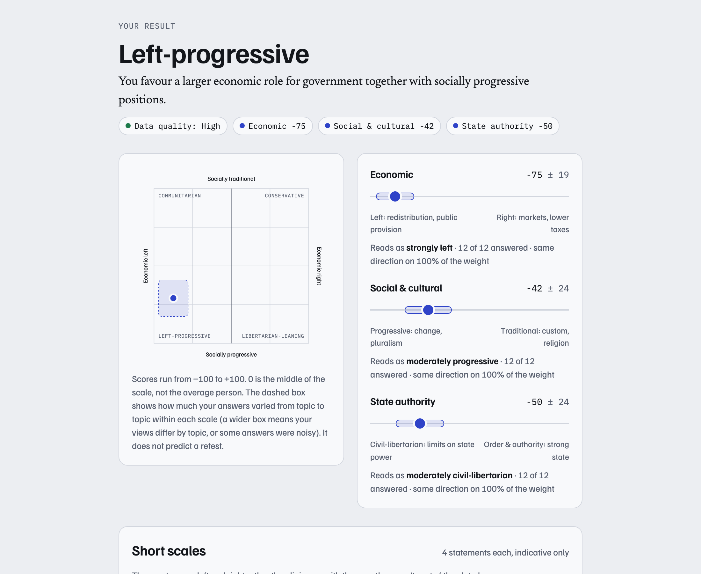
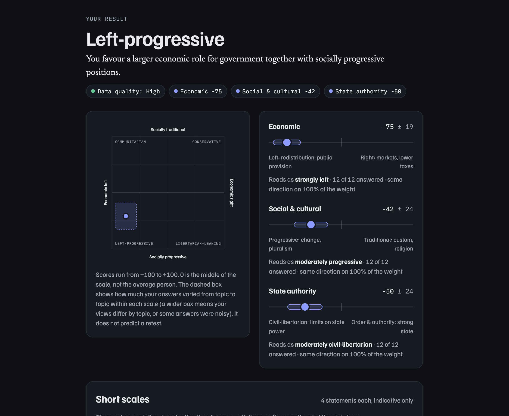

# Ideology Inventory

**Where do your views actually sit?** A research-informed political-orientation inventory that places
you on separate economic, social and state-authority scales, adds short scales for climate, trade and
populism, profiles six moral foundations, and checks how much to trust your own answers.

**Live:** https://polskew.ankitkapoor.me

<p>
  
  
</p>

## What it measures

| Scale                                             | Items                                                                | − pole                           | + pole                   |
| ------------------------------------------------- | -------------------------------------------------------------------- | -------------------------------- | ------------------------ |
| Economic                                          | 12 (6 pairs)                                                         | redistribution, public provision | markets, lower taxes     |
| Social & cultural                                 | 12 (6 pairs)                                                         | change, pluralism                | custom, religion         |
| State authority                                   | 12 (6 pairs)                                                         | limits on state power            | order and a strong state |
| Climate & energy · Trade & sovereignty · Populism | 4 each                                                               |                                  |                          |
| Moral foundations                                 | 18 (3 × care, equality, proportionality, loyalty, authority, purity) |                                  |                          |

Plus an attention check, an implausible-statement check and a 7-point self-placement asked last:
69 screens, about 12 minutes.

## Why it looks like this

- **Two dimensions, not one line.** Only about 45% of a U.S. national sample fit a single left–right
  dimension; economic and social ideology are the minimum two needed to account for policy
  preferences ([Feldman & Johnston, 2014](https://scholars.duke.edu/publication/745676); see also
  Everett's [SECS, 2013](https://www.ncbi.nlm.nih.gov/pmc/articles/PMC3859575/)). A third scale
  follows the authoritarian–libertarian distinction in Duckitt and Sibley's dual-process model.
- **Moral foundations** use the six MFQ-2 constructs, which split fairness into equality and
  proportionality ([Atari et al., 2023](https://link.springer.com/article/10.1007/s12144-025-07630-4)).
  The wording is original, and results are scored relative to your own average.
- **Populism** draws on the populist-attitudes construct of
  [Akkerman, Mudde & Zaslove (2014)](https://research.vu.nl/en/publications/how-populist-are-the-people-measuring-populist-attitudes-in-voter/),
  with every item balanced by an opposite.

## Noise controls

- **Matched, balanced pairs.** Every ideology statement has a partner on the same topic, of equal
  strength, pointing the other way, shown at least eight items later. A habit of agreeing
  ([acquiescence](https://methods.sagepub.com/ency/edvol/embed/encyclopedia-of-survey-research-methods/chpt/acquiescence-response-bias))
  cancels out.
- **Neutral items.** Each statement is a value or preference rather than a factual claim, makes one
  claim, and names no party or politician.
- **"No opinion" counts as missing, not neutral**, so it widens the band instead of pulling you to 0.
- **Seven quality checks:** attention, implausible statement, contradictory pairs, agreement
  tendency, response variety, reading speed and no-opinion count, combined into a High, Moderate or
  Low grade.
- **Self-placement comes last**, so the label can't anchor your answers. The app then compares
  your label with your positions (symbolic vs. operational ideology).

## Optional modules

- **Compare with Americans.** Eleven questions copied word for word from the
  [ANES 2024 Time Series](https://electionstudies.org/anes-announcement-full-release-of-the-2024-time-series-study/)
  and the [CES 2024](https://doi.org/10.7910/DVN/X11EP6), asked in their original format and compared
  with weighted national distributions. The main scales are never turned into percentiles; only
  exact source wording can be benchmarked. See [`data/SOURCES.md`](data/SOURCES.md).
- **Help validate it.** Explicit consent before the quiz enables automatic anonymous sharing on
  completion (no IP, email, cookies or exact timestamp; deletion code
  shown once; optional test–retest token) feeds a reliability, factor-analysis, IRT and retest
  pipeline in R. See [`docs/PRIVACY.md`](docs/PRIVACY.md) and [`scripts/analysis`](scripts/analysis).
- **Keep your results** as a PDF report (vector compass), a PNG share card (1200×1500 or
  1080×1080), a text summary or a JSON file of your raw data. Everything is generated in the browser.

## Limitations

The items have not been field-tested yet. Scores show your position relative to the **scale
midpoint, not the average person**. The band shows item-to-item spread, not retest reliability.
Word-label cutoffs (15 / 40 / 70) are provisional and come from what the answers mean, not from
population data. Issue salience differs by country. The app states all of this where the numbers
appear.

## Stack

Vite + **vanilla TypeScript**. The prototype was a single file of template-string rendering, and a
framework would add weight without simplifying a one-question-at-a-time flow. Scoring is pure,
side-effect-free functions with unit tests. Styling uses CSS tokens (light and dark), self-hosted
Familjen Grotesk, Newsreader and IBM Plex Mono, and motion that respects `prefers-reduced-motion`.
It is served by a **Cloudflare Worker** with static assets, with **D1** for opt-in submissions and
**Turnstile** for bot checks.

```
src/instrument/   item bank, run order (seedable), instrument version (semver + hash)
src/scoring/      scale scores, moral foundations, quality checks, labels, self-placement
src/benchmark/    ANES/CES benchmark spec and percentile scoring
src/consent/      sharing policy, payload, retest token
src/export/       text/JSON, canvas share card, jsPDF report
src/ui/           intro, question, results, benchmark, sharing, exports
worker/           API: /api/config, POST /api/submissions, DELETE /api/submissions/:id
migrations/       D1 schema
scripts/norms/    Python: weighted norms from ANES/CES microdata
scripts/analysis/ R: reliability, EFA/CFA, IRT, test–retest report
legacy/           the original single-file prototype (reference only)
```

## Development

```bash
npm install
npm run dev            # http://localhost:5173  (add ?norms=fixture to try the benchmark with synthetic data)
npm test               # unit tests (Vitest)
npm run test:e2e       # browser tests (Playwright; first run: npx playwright install chromium)
npm run lint && npm run typecheck
npm run build          # checks the instrument hash, then builds to dist/
```

Full stack locally (Worker, local D1, Turnstile test keys):

```bash
cp .dev.vars.example .dev.vars
npm run db:migrate:local
npm run dev:worker     # http://localhost:8787
```

Norms pipeline (Python) and analysis (R): see [`scripts/norms/README.md`](scripts/norms/README.md)
and [`scripts/analysis/README.md`](scripts/analysis/README.md).

### Changing the instrument

Any change to item wording, keying or a scoring constant changes the instrument hash, and
`npm run build` fails until you bump `INSTRUMENT_SEMVER` in `src/instrument/version.ts` and run
`npm run version:gen` and `npm run analysis:key`. Stored and submitted responses always record the
version they were collected under.

## Deploy (Cloudflare)

```bash
npx wrangler login
npx wrangler d1 create pol-skew          # paste the database_id into wrangler.jsonc
npm run db:migrate:remote
npm run deploy                           # builds and deploys; serves polskew.ankitkapoor.me
```

Production collection is enabled. Before question 1, each run asks for explicit sharing consent
and age-18 confirmation, with a separate **Continue without sharing** choice. Consented completed
runs submit automatically after a fresh Turnstile check and show a deletion receipt. Declined and
incomplete runs send no responses. See [`docs/PRIVACY.md`](docs/PRIVACY.md).

The production Turnstile site key is in `wrangler.jsonc`; its secret is an encrypted Cloudflare
binding, never committed. On a new deployment account, create a Turnstile widget for the live
hostnames and set `TURNSTILE_SECRET` using `npx wrangler secret put TURNSTILE_SECRET`. Pause
collection by setting `COLLECTION_ENABLED` to `"false"` and redeploying.

U.S. norms appear once `data/norms/us-2024.json` is built from the raw ANES and CES files
(`npm run norms`) and committed. Until then the benchmark offer is hidden in production.
